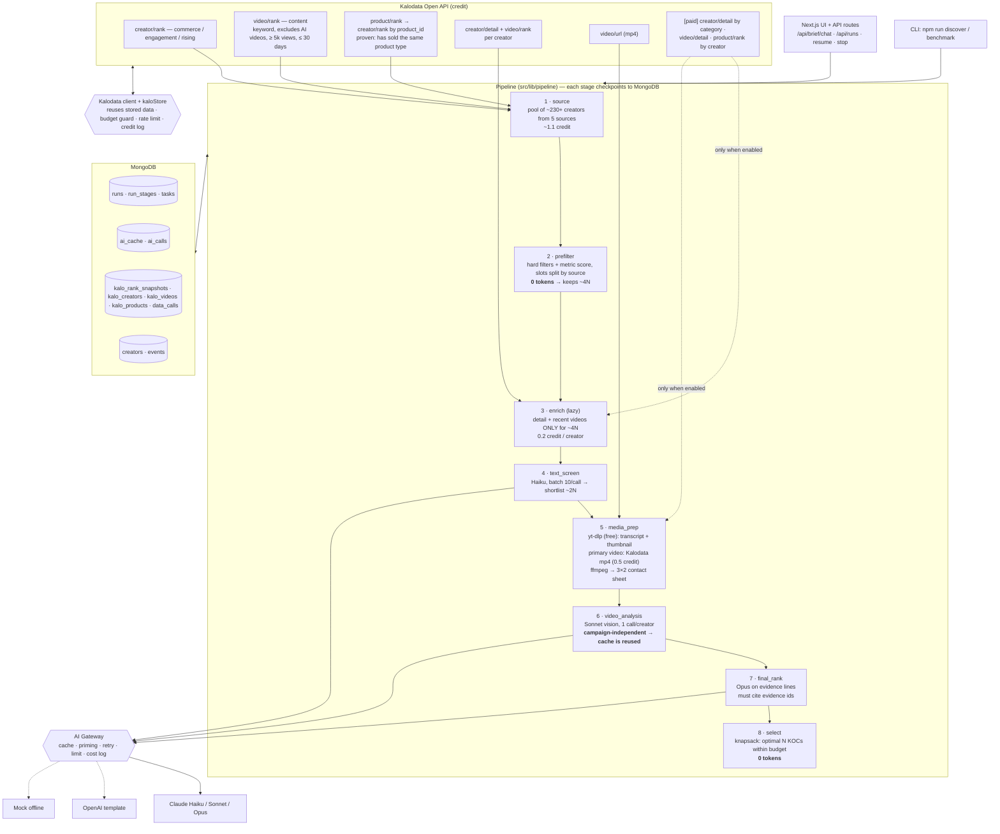

# Architecture — AI KOC Discovery

🇻🇳 Tiếng Việt: [ARCHITECTURE.md](ARCHITECTURE.md) · Feature table: [FEATURES.en.md](FEATURES.en.md) · Overview: [README.en.md](../README.en.md)

## 1. Overview

The system is a **funnel-shaped pipeline**: the further down a creator goes, the more each creator costs (data credits + AI tokens), so the number of creators has to shrink quickly. Most of the elimination is done with metrics (0 tokens). AI is used only for what the numbers cannot answer: content style, video quality, brand risk.

**Two kinds of cost** are optimized in parallel:

| Type | Unit | Example |
|---|---|---|
| Data (Kalodata Open API) | credit (1 ≈ $0.1) | rank 0.1 / 100 rows · detail 0.1 · video URL **0.5** |
| AI (Claude) | token | Haiku $0.1/$0.5 · Sonnet $2/$10 · Opus $4/$20 per MTok |



Demo brief (N = 5, measured 2026-11-17): pool 224 → prefilter keeps 20 → enrich 20 → text AI 20 (**2 calls**) → video AI 10 (**10 calls**) → final 10 (**1 call**) → select 5. Total **13 AI calls + 9.4 credits**, about **$1.34 for a first run** (no AI cache, no stored data), 0 for a repeated run.

## 2. Key decisions

### 2.1 Cheap → expensive funnel (the biggest lever)

| Stage | Cost / creator | Creators (N=5) | Why it sits at this position |
|---|---|---|---|
| source | ~0.002 credit | 224 | The rank API is billed per 100-row page → a large pool is almost free |
| prefilter | 0 | 224 → 213 pass hard filters | Followers, category, views, GMV, video/live ratio and cost are **numbers**; no AI needed |
| enrich | 0.2 credit | 20 | Detail + video list are fetched only for candidates worth a closer look (lazy enrichment) |
| text_screen | ~$0.0002 (Haiku, batched) | 20 | Reads caption / bio / sales mix to understand niche and risk |
| media_prep + video_analysis | 0.5 credit + ~$0.021 | 10 | Most expensive → shortlist only |
| final_rank | ~$0.019 (Opus, compact text) | 10 | Best reasoning, but the input is already compressed into evidence lines |

Funnel sizes are defined in `funnelFor()` (`src/lib/config.ts`) and scale with N.

### 2.2 Multi-signal retrieval (5 sources) + prefilter slots split by source

Kalodata is **TikTok Shop** data. The first run ranked by revenue only; the pool was made up entirely of "deal-poster" affiliates (promoting 300–500 products, ER < 1%), and the AI scored all of them low. So the pool is drawn from 5 complementary sources:

1. **commerce** (~0.1 cr): ranked by `video_revenue` (not total revenue, which is dominated by livestream sellers) → creators who have proven they can sell through video.
2. **engagement** (~0.1 cr): `engagement_rate = MEDIUM` (≥ 8%) in the Skincare category, ranked by video revenue → creators with organic pull who are in the right category (skincare).
3. **content** (~0.1 cr / keyword): `video/rank` by product keyword, **excluding AI-generated videos (`is_ai_video=0`), excluding videos under 5,000 views (`views_range`), only videos posted within 30 days (`publish_date_range`)** → creators who **already make** the right kind of content, without junk videos mixed in.
4. **proven** (~0.6 cr): top 5 products by keyword (`product/rank`), then the sellers of each product (`creator/rank` filtered by `product_id`) → creators who **have actually sold** the same type of product. Evidence from orders is stronger than guessing from captions.
5. **rising** (~0.1 cr): ranked by `revenue_growth_rate` in Skincare, with a revenue floor of 10 million VND → creators on the rise, often still inexpensive.

Each source runs independently: if one source fails (API, parameters), only a warning is logged and the other sources still run. Prefilter **splits the kept slots evenly across sources**, so one group (e.g. high-selling affiliates) cannot take all 20 enrich slots. Cheap filters are pushed down to the API: VN, category, follower range, `creator_type = INDEPENDENT` (excludes shop/brand accounts).

### 2.3 Lazy enrichment

Calling detail + videos for the whole pool of 224 creators costs ~45 credits. Calling them only for the 20 creators that pass prefilter costs 4 credits (**~90% less**). After enrichment, the metric score is **recomputed** on the full data (real engagement from videos, keywords in captions, ad-view ratio, number of products/shops being promoted) and the hard filters are applied again.

### 2.4 Model tiering

Each stage uses the cheapest model that is good enough (override with the `MODEL_*` env vars):

- `text_screen` → `claude-haiku-5-5`: bulk text classification.
- `video_analysis` → `claude-sonnet-5-5`: good vision, half the price of Opus.
- `final_rank` → `claude-opus-5-5`: reasoning + writing justifications with citations; runs only on the shortlist.

`output_config.effort` = `low` for screen/video, `medium` for final. Opus/Sonnet have server-side refusal fallback enabled.

### 2.5 *Campaign-independent* video analysis → reusable cache

The `video_analysis` prompt **does not contain the brief**. The output is an objective "content profile" (format, whether the product is applied to skin, texture close-ups, filming quality, persona, brand safety…). Cache key = hash(images + caption + transcript + prompt version), so:

- Resume after a crash: 0 tokens for the part already analyzed.
- A later campaign (lipstick, serum…) that meets the same creator again: **0 tokens + 0 credits** for the most expensive part (the contact sheet is also cached on disk).
- Judging "does this fit the campaign or not" is left to `final_rank`, working on compact text.

### 2.6 Media: free first, paid under control, contact sheet

- **yt-dlp (free)** fetches TikTok's **Vietnamese auto-captions** (a full transcript of the speech, no need to run ASR) + thumbnails for every video. TikTok often also returns a machine-translated English track; the code always prefers `vie`/`vi` subtitles, uses `en` only when there is no Vietnamese track, and re-reads the subtitles every time cached media is used (an earlier version had mistakenly taken the English translation for 25/55 videos).
- TikTok currently blocks video formats for non-app clients (yt-dlp only gets audio, even when impersonating), so each creator's **primary video** is fetched as mp4 via Kalodata `video/url` (0.5 credit). The second video uses only thumbnail + transcript (free). Configured via `KALODATA_VIDEO_URL_FALLBACK = primary | all | off`.
- `video/url` is an async API: error `1054 "Video is being fetched"` is not charged → the client waits 5s and calls again.
- 6 frames at fixed points (~1s for the hook, then 20/40/60/80/95%) → resized to 240×426 → **3×2 contact sheet (720×852)**. Claude image tokens ≈ (w×h)/750 ≈ **~820 tokens / video**, versus ~9.6k if the 6 frames were sent at full resolution → **~90% less**. The original video is deleted after frame extraction; only the ~60KB sheet is kept.
- A creator's 2 videos are combined into **1 call** → the system prompt is counted only once.
- **Main limitation of this approach**: the model currently reads images, not video, so 6 still frames are used as a substitute. They miss motion (applying, spreading, rubbing in the texture), editing rhythm, audio, and detail between frames. **A model that reads the original video well would improve the analysis substantially.** When one is available, only the input of the `video_analysis` stage needs to change (MP4 instead of the contact sheet); the output schema, cache and later stages stay the same.

### 2.7 Batching, prompt caching (with priming), compact input

- `text_screen` / `final_rank` batch 10 creators / call.
- The static part (rubric + brief) sits in `system` with `cache_control`.
- **Cache priming**: on the first run, 2 batches ran in parallel, so **both wrote the cache** (measured: `cache_write 2194` ×2, `cache_read 0`). The gateway now lets the first call for each (model, system) pair run first; later calls wait and then run in parallel so they read the cache (~0.05–0.1× the input price).
- Each creator is serialized into a ~150-token "card" (abbreviated numbers `85k`, `6.1%`) instead of raw JSON of several thousand tokens. Short refs `c3`, `c3.v1.o2`.

### 2.8 Structured outputs + Zod, failed calls are recorded too

- Every AI call uses a JSON schema generated from Zod (`src/lib/ai/schema.ts`). The output is still re-validated with Zod.
- **A real bug that was hit and fixed**: the function that makes the schema "strict" removed the JSON Schema `format` keyword, but it also removed the **property named `format`** in the video schema, causing 10/10 video calls to fail validation. Fix: it no longer touches key names inside `properties`.
- A call that returns JSON not matching the schema, or that is cut off by `max_tokens`, **still costs money** → the provider attaches `usage` to the error, and the gateway writes it to `ai_calls` with `ok = 0`. Reported cost is always accurate.

### 2.9 Evidence with IDs + citation checking (anti-fabrication)

`evidence.ts` turns metrics and video observations into a list of evidence items with IDs:

```
[c6.m1] Followers 76k; 73.6M view nội dung / 30 ngày; trung vị 3.2M view của các video nổi bật (reach top 16% pool)
[c6.m6] 100% doanh thu từ video, 0% từ livestream; quảng bá 161 sản phẩm / 128 shop; trung bình 19% view video đến từ quảng cáo
[c6.v1.o1] [frame 1 @1s] Mặt đã chấm nhiều điểm kem trắng ở má, mũi, trán; tay cầm tuýp kem màu hồng
```

(English gloss: `c6.m1` 76k followers, 73.6M content views per 30 days, median 3.2M views across featured videos, reach in the top 16% of the pool; `c6.m6` 100% of revenue from video, 0% from livestream, promotes 161 products across 128 shops, on average 19% of video views come from ads; `c6.v1.o1` face already dotted with white cream on the cheeks, nose and forehead, hand holding a pink cream tube.)

`final_rank` requires every reason/risk to cite 1–3 IDs. The code checks them again: IDs that do not exist or that belong to another creator are dropped and recorded in `invalidEvidence`. In the UI, an ID can be clicked to view the evidence; video evidence shows the contact sheet and **circles the exact frame** that was cited.

### 2.10 Final score "anchored" to metrics + budget optimization

- `final = 0.7 × fit_score (AI, rubric) + 0.3 × dataScore (metrics)`.
- `select` solves a **cardinality-constrained knapsack**: it picks exactly N creators with the highest total score whose total cost ≤ budget (exact DP when small, greedy when large).
- Booking cost is estimated from a **rate card by follower tier** (`DEFAULT_RATE_CARD` in `scoring.ts`). This is an assumption.

### 2.11 Reliability

| Mechanism | Where | Effect |
|---|---|---|
| Stage-level checkpoint | `run_stages` | Stage finishes → output is saved → resume skips it |
| Task-level checkpoint | `tasks` | Finished tasks are not rerun; `running` tasks of a dead process are reset to `pending` |
| Deterministic plan | `StageDef.plan` | Resume rebuilds exactly the same task list (upsert `$setOnInsert`: existing tasks keep their state) |
| Idempotent + `ai_cache` | `ai/gateway.ts` | Crash *after* paying for AI but *before* writing the task → the next attempt hits the cache |
| Kalodata data store + media on disk | `kaloStore.ts`, `media/video.ts` | Credits are never paid twice; if the API fails, older data is used; signed URLs are reused only while they have not expired |
| Credit budget guard | `KALODATA_MAX_CREDITS_PER_RUN` (default 12) + enabled paid features | Blocks **before** the call if the cap would be exceeded |
| Per-endpoint rate limit | `kalodataApi.ts` | rank / video: 10 req / 10s; detail: 500 req / 10s |
| Lease + heartbeat | `runs.leaseOwner / leaseUntil` | Each run has only 1 worker (conditional `findOneAndUpdate` = atomic); worker dies → lease expires → another worker takes over |
| Dead-owner detection | `isDeadLocalOwner` | Same machine, lease owner's PID no longer exists → take over immediately |
| Multi-layer retry | SDK + gateway + runner + Kalodata client | Transient errors do not break the run; output cut off by `max_tokens` → limit is doubled |
| Tolerate failures | source (per source), enrich, media_prep, video_analysis | 1 failed source / creator / video does not fail the whole run |
| Graceful stop | `/api/runs/:id/stop` | Stops accepting new tasks; tasks already running finish |

The benchmark hard-kills the process (`process.exit(137)`) in the middle of `video_analysis`, resumes in a new process, and checks that **0 calls are paid for twice**.

### 2.12 Making full use of already-paid Kalodata data (0 extra credits)

The `creator/detail` and `video/rank` responses contain many fields that used to be ignored. They are now used (`src/lib/pipeline/signals.ts`):

| Signal | Source | Where it is used |
|---|---|---|
| **Organic views** = views × (1 − `ad_view_ratio`) | `video/rank` | Reach, median views and views per 1 million ₫ are all computed on organic views. ~3/4 of the videos in the pool ran ads; 105/614 videos have ≥ 50% paid views. |
| **Video GPM** (`video_gpm`, revenue / 1000 views) | `creator/detail` | Commerce score = 60% GPM + 40% revenue when GPM is available → no bias toward large accounts. GPM in the pool varies by ~13×. |
| **Average price of products sold** (`unit_price`) | `creator/detail` | Evidence m7, so the AI can compare the price segment with the product. |
| **Momentum** (`new_followers`, 30-day `revenue_trend`) | `creator/detail` | New `momentum` component (5%) in the metric score; evidence m8 (number of days with revenue, trend). |
| **AI-generated videos** (`ai_video`), debut date | `video/rank` | Added to the content-reading card and to evidence m8. |
| **Contact channels** (`creator_contact_*`) | `creator/detail` | Only the channel NAME is stored (Email, Zalo…) so the marketer knows how to book; contact values are not stored. |

Signals from `creator/detail` exist only after the enrich step (~20 creators), so they feed into the post-enrich re-score, the content-reading step and the final scoring, not into the coarse filter over ~224 creators (missing = neutral). New weights: `videoFocus` 0.10 → 0.05, plus `momentum` 0.05.

### 2.13 Conversational brief intake: code decides, AI only interprets language

The user can fill in a form or describe the campaign in their own words. The brief is split into **slots** (product, gender, age, budget, number of KOCs; optional: follower scale, selling points).

- **Code** picks the next missing slot and builds the options for the question (budget levels, age groups, number of KOCs, follower tier). An answer chosen from the options is applied to the brief by code, not through the AI → exact, 0 tokens.
- **AI** (Haiku, effort low, structured output) handles only the parts that need language understanding: extracting information from free text ("5 bạn review cho nữ sinh viên, tầm 30 củ" (5 reviewers for female university students, around 30 million VND)), writing natural questions tailored to the product, and suggesting TikTok keywords and selling points for the user to choose from. A question written by the AI is used only when it matches the slot the code picked.
- Messages sent from the form are the source of truth: the AI may not overwrite form values.
- The server keeps no conversation state; the client resends the whole conversation (a few KB). When a campaign is created, the conversation is saved to `runs.chat` and the cost of the intake turns is attributed to the campaign (`ai_calls.stage = brief_intake`).

### 2.14 Kalodata data store in MongoDB (replacing the response cache)

Kalodata data that has been paid for with credits is **real app data**, not a temporary cache (`src/lib/sources/kaloStore.ts`):

- **Rank snapshots** (`kalo_rank_snapshots`): every call to `creator/rank`, `video/rank`, `product/rank` stores the endpoint, parameters, timestamp, credits and the result rows in their exact order (≤ 100 rows → embedded in the document).
- **Entities** (`kalo_creators`, `kalo_videos`, `kalo_products`): upserted from every snapshot, with key metric columns for querying (followers, revenue, GPM, views, ad-view ratio…). The creator ↔ sold-product relation is recorded in both directions. Detail responses (creator, creator by category, video) are embedded directly in the entity (1:1). For contacts, only the **channel name** is stored.
- **Reuse:** same parameters within `KALODATA_DATA_MAX_AGE_HOURS` (default 7 days) → 0 credits, recorded as `data_calls.cacheHit = true` together with the number of credits saved. **API failure** (key rejected, network, cap reached) when older data exists → the older data is used, with a warning in the campaign log.
- Data from the old SQLite version (`kalo_cache`) is converted by `npm run migrate:sqlite` into snapshots + entities, so no paid credits are lost.

### 2.15 Deep data is a paid feature and must be enabled

3 items cost extra credits, so they are **off by default**; the user enables them on the brief confirmation card (`src/lib/brief/paid.ts`, `DeepDataPanel`):

| Item | API | Runs at step | Used for |
|---|---|---|---|
| Revenue by category | `creator/detail` + `category_ids` | enrich (~4N creators) | Share of revenue in the category → blended 50/50 into the category score; evidence m9 |
| Video detail | `video/detail` | media_prep (2 videos × ~2N creators) | GPM, ROAS, number of days ads ran, CPA of the exact videos the AI watches; evidence m11 |
| Products the creator is selling | `product/rank` filtered by `creator_id` | media_prep (~2N creators) | Same-type / competitor products; evidence m10 |

- Enabling any item → the UI shows a paid-feature warning with the estimated credits, and the run button shows "+X credit".
- `PAID_FEATURES=demo` (default) allows enabling them on a trial basis; `off` locks them (API returns 403).
- When a campaign is created, the server adds exactly the credits the user agreed to onto the campaign's cap (`config.paidCreditsBudget`).
- Errors while fetching deep data only log a warning and do not fail the creator.

## 3. Scalability: 50–500 KOCs

| N | Pool | Enrich + text AI | Video AI | AI | Kalodata | Total ≈ |
|---|---|---|---|---|---|---|
| 5 | 100/source | 20 | 10 | $0.40 | 9.4 cr | $1.34 |
| 50 | 1 000/source | 200 | 100 | $4.0 | 94 cr | $13.4 |
| 500 | 10 000/source | 2 000 | 1 000 | $40 | 940 cr | $134 |

At large scale, **data cost (video URL at 0.5 credit) exceeds AI cost**. Mitigations already prepared:

- **Cross-campaign cache**: video profiles are campaign-independent → when the same set of creators recurs, the marginal cost drops to 0.
- `KALODATA_VIDEO_URL_FALLBACK=off` + use only thumbnail + transcript for the first tier; pay 0.5 credit only for the final top candidates.
- **Message Batches API** (−50% AI price) for `text_screen` / `video_analysis` (no real-time requirement): each task maps 1-1 to 1 batch request (`custom_id = task_key`).
- **Independent tasks** → multiple workers pull tasks with a conditional `findOneAndUpdate` (already used for the lease); a MongoDB replica set when moving to production.
- Separate media workers (CPU/bandwidth) from AI workers; `MEDIA_CONCURRENCY` and `AI_CONCURRENCY` are tuned independently according to rate limits.

## 4. Data model (MongoDB)

Designed around how the app reads / writes, not a 1:1 copy of SQL tables:

| Collection | Role | Design notes |
|---|---|---|
| `runs` | 1 campaign = 1 document: brief, brief-intake conversation (`chat`), config snapshot, status, lease, timestamps, results | Lease is updated atomically with `findOneAndUpdate` |
| `run_stages` | Per-step checkpoint + output + timing | ≤ 8 documents / campaign; output is preloaded into memory on run / resume |
| `tasks` | Per-task checkpoint (input, output, attempts, error, `seq` in plan order) | Separate collection: parallel, independent updates, up to hundreds of tasks / step |
| `creators` | Normalized creators (bio with phone numbers/emails masked) **per campaign** (`_id` = `runId:creatorId`): they carry brief-specific data (sources, keyword videos, same-type products), so they are not shared. Cross-campaign reuse lives in `kalo_*` and `ai_cache` | |
| `ai_cache` / `ai_calls` | AI result cache keyed by content hash; log of every call (tokens, cost, latency, cache hit, ok) | |
| `kalo_rank_snapshots` | Each Kalodata ranking call | Results embedded; index `paramsHash + fetchedAt` |
| `kalo_creators` / `kalo_videos` / `kalo_products` | Kalodata entities + embedded detail | Metric columns for querying |
| `data_calls` | Kalodata credit log: actually paid / reused / saved | |
| `events` | Progress log for the UI | Writes do not block the main flow; `flushEvents()` before exit |

## 5. Code structure

```
src/lib/
  config.ts            env, model tiering, funnel sizing
  db.ts                MongoDB: connection, document types, indexes, progress log
  ai/                  gateway (cache/priming/retry/limit/log), providers (anthropic, openai, mock), pricing, schema
  sources/
    kalodataApi.ts     Kalodata Open API client: budget guard, rate limit, credit log
    kaloStore.ts       Kalodata data store (snapshots + entities), reuse / fall back to older data when the API fails
    kalodata.ts        search (5 sources) + enrich + deep data (paid) -> CreatorRecord
    fixture.ts         synthetic data for offline mode
  media/video.ts       yt-dlp (free) / Kalodata mp4 (paid) -> contact sheet + transcript
  pipeline/
    runner.ts          orchestrator: checkpoint, lease, retry, stop/resume
    stage.ts           StageDef (plan -> exec -> reduce)
    stages/*.ts        8 stages
    scoring.ts         prefilter scoring (0 token) + rate card
    signals.ts         signals from Kalodata data: organic views, GPM, momentum, same-type products...
    evidence.ts        evidence ids + validation
    optimizer.ts       knapsack that picks N KOCs within budget
    prompts.ts         system prompts (versioned)
    schemas.ts         Zod schemas for structured outputs
  brief/slots.ts       brief slots (shared by form + chat): presets, money/age parsing, applying answers, draft -> brief
  brief/intake.ts      AI brief intake: code picks the missing slot + builds options, AI interprets free text + suggests keywords/USPs
  brief/paid.ts        deep data catalog (paid) + credit estimate, shared by client/server
  steps.ts             per-step research summaries for the UI (description, 1-line result, detail list)
src/app/               Next.js UI + API routes (/, /new, /runs/[id]; /api/brief/chat, /api/runs)
src/components/        brief/ (RHF + zod form, controls, DeepDataPanel), chat/ (thread, composer, avatar), StepProcess, KocReview
scripts/               CLI discover, benchmark, gen-fixtures, migrate-sqlite
```
