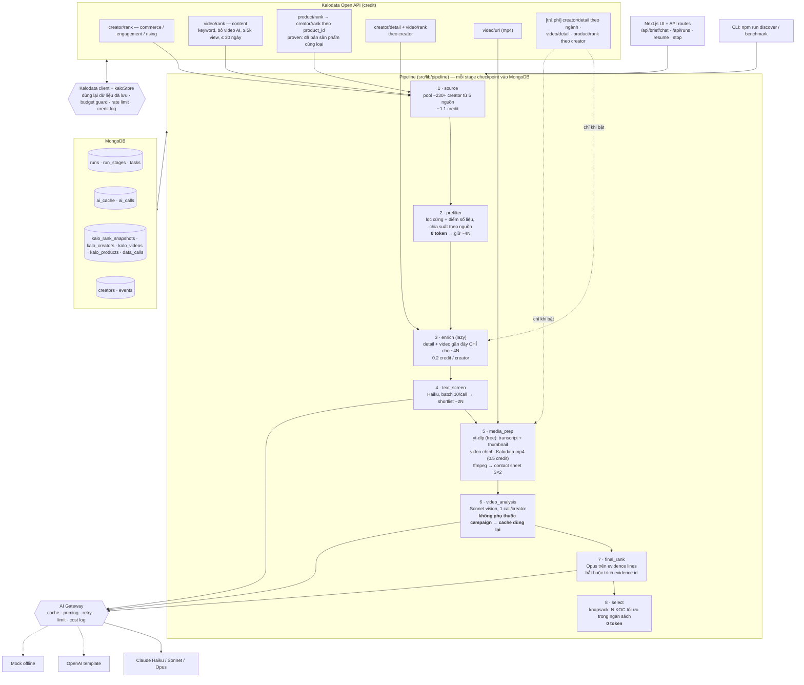

# Kiến trúc — AI KOC Discovery

🇬🇧 English: [ARCHITECTURE.en.md](ARCHITECTURE.en.md) · Bảng tính năng: [FEATURES.md](FEATURES.md) · Tổng quan: [README.md](../README.md)

## 1. Tổng quan

Hệ thống là một **pipeline dạng phễu (funnel)**: càng xuống sâu, mỗi creator càng tốn nhiều chi phí hơn (credit dữ liệu + token AI), nên số creator phải giảm nhanh. Phần lớn việc loại bỏ được làm bằng số liệu (0 token). AI chỉ dùng cho những gì số liệu không trả lời được: phong cách nội dung, chất lượng video, rủi ro thương hiệu.

Có **2 loại chi phí** được tối ưu song song:

| Loại | Đơn vị | Ví dụ |
|---|---|---|
| Dữ liệu (Kalodata Open API) | credit (1 ≈ $0.1) | rank 0.1 / 100 dòng · detail 0.1 · video URL **0.5** |
| AI (Claude) | token | Haiku $0.1/$0.5 · Sonnet $2/$10 · Opus $4/$20 per MTok |



Brief demo (N = 5): pool 234 → prefilter giữ 20 → enrich 20 → text AI 18 (**2 call**) → video AI 10 (**10 call**) → final 10 (**1 call**) → chọn 5. Tổng **13 call AI + ~9.4 credit** (đo trước khi thêm 2 nguồn mới; 2 nguồn này cộng ~0.7 credit), khoảng **$1.33 / run lạnh**, 0 cho run lặp lại.

## 2. Các quyết định chính

### 2.1 Funnel rẻ → đắt (đòn bẩy lớn nhất)

| Stage | Chi phí / creator | Số creator (N=5) | Vì sao ở vị trí này |
|---|---|---|---|
| source | ~0.002 credit | 234 | Rank API tính theo trang 100 dòng → pool lớn gần như miễn phí |
| prefilter | 0 | 234 | Follower, ngành hàng, view, GMV, tỷ lệ video/live, chi phí là **số**, không cần AI |
| enrich | 0.2 credit | 20 | Detail + danh sách video chỉ lấy cho ứng viên đáng xem (lazy enrichment) |
| text_screen | ~$0.0002 (Haiku, batch) | 18 | Đọc caption / bio / cơ cấu bán hàng để hiểu ngách và rủi ro |
| media_prep + video_analysis | 0.5 credit + ~$0.02 | 10 | Đắt nhất → chỉ cho shortlist |
| final_rank | ~$0.018 (Opus, text gọn) | 10 | Suy luận tốt nhất nhưng input đã nén thành evidence lines |

Kích thước funnel ở `funnelFor()` (`src/lib/config.ts`), scale theo N.

### 2.2 Multi-signal retrieval (5 nguồn) + chia suất prefilter

Kalodata là dữ liệu **TikTok Shop**. Lần chạy đầu chỉ xếp theo doanh thu, pool toàn affiliate "deal-poster" (quảng bá 300–500 sản phẩm, ER < 1%), AI chấm thấp đồng loạt. Vì vậy pool lấy từ 5 nguồn bổ sung cho nhau:

1. **commerce** (~0.1 cr): xếp theo `video_revenue` (không phải tổng doanh thu vốn bị seller livestream chiếm) → creator chứng minh được khả năng bán qua video.
2. **engagement** (~0.1 cr): `engagement_rate = MEDIUM` (≥ 8%) trong ngành Skincare, xếp theo doanh thu video → creator có sức hút tự nhiên và đúng ngành chăm da.
3. **content** (~0.1 cr / từ khoá): `video/rank` theo keyword sản phẩm, **bỏ video AI tạo (`is_ai_video=0`), bỏ video < 5.000 view (`views_range`), chỉ video đăng trong 30 ngày (`publish_date_range`)** → creator **đã làm** đúng loại nội dung, không lẫn video rác.
4. **proven** (~0.6 cr): top 5 sản phẩm theo keyword (`product/rank`), rồi người bán từng sản phẩm (`creator/rank` lọc `product_id`) → creator **đã bán thật** sản phẩm cùng loại. Bằng chứng từ đơn hàng, mạnh hơn đoán từ caption.
5. **rising** (~0.1 cr): xếp theo `revenue_growth_rate` trong Skincare, có sàn doanh thu 10 triệu → creator đang lên, thường còn rẻ.

Mỗi nguồn chạy độc lập: 1 nguồn lỗi (API, tham số) chỉ ghi cảnh báo, các nguồn khác vẫn chạy. Prefilter **chia đều suất giữ lại theo nguồn**, nên một nhóm (vd affiliate bán mạnh) không chiếm hết 20 suất enrich. Filter rẻ được đẩy xuống API: VN, ngành hàng, khoảng follower, `creator_type = INDEPENDENT` (loại tài khoản shop/brand).

### 2.3 Lazy enrichment

Gọi detail + video cho cả pool 234 creator tốn ~47 credit. Chỉ gọi cho 20 creator qua prefilter thì tốn 4 credit (**giảm ~90%**). Sau khi enrich, điểm số liệu được **chấm lại** trên dữ liệu đầy đủ (engagement thật từ video, keyword trong caption, tỷ lệ view quảng cáo, số sản phẩm/shop đang quảng bá) và áp lại hard filter.

### 2.4 Model tiering

Mỗi stage dùng model rẻ nhất đủ chất lượng (override bằng env `MODEL_*`):

- `text_screen` → `claude-haiku-5-5`: phân loại text hàng loạt.
- `video_analysis` → `claude-sonnet-5-5`: vision tốt, rẻ bằng một nửa Opus.
- `final_rank` → `claude-opus-5-5`: suy luận + viết lý do có trích dẫn, chỉ chạy trên shortlist.

`output_config.effort` = `low` cho screen/video, `medium` cho final. Opus/Sonnet bật server-side refusal fallback.

### 2.5 Phân tích video *không phụ thuộc campaign* → cache dùng lại

Prompt `video_analysis` **không chứa brief**. Output là "hồ sơ nội dung" khách quan (format, có thoa lên da không, cận texture, chất lượng quay, persona, brand safety…). Cache key = hash(ảnh + caption + transcript + prompt version), nên:

- Resume sau crash: 0 token cho phần đã phân tích.
- Campaign sau (son, serum…) gặp lại creator: **0 token + 0 credit** cho phần đắt nhất (contact sheet cũng cache trên đĩa).
- Việc đánh giá "hợp campaign không" để `final_rank` làm trên text gọn.

### 2.6 Media: miễn phí trước, trả phí có kiểm soát, contact sheet

- **yt-dlp (miễn phí)** lấy **auto-caption tiếng Việt** của TikTok (transcript đầy đủ lời nói, không cần chạy ASR) + thumbnail cho mọi video. TikTok thường trả kèm bản máy dịch tiếng Anh; code luôn ưu tiên phụ đề `vie`/`vi`, chỉ dùng `en` khi không có tiếng Việt, và đọc lại phụ đề mỗi lần dùng media đã cache (bản cũ từng lấy nhầm bản dịch tiếng Anh cho 25/55 video).
- TikTok hiện chặn format video với client không phải app (yt-dlp chỉ nhận được audio, kể cả khi impersonate), nên **video chính** của mỗi creator lấy mp4 qua Kalodata `video/url` (0.5 credit). Video thứ 2 chỉ dùng thumbnail + transcript (miễn phí). Cấu hình qua `KALODATA_VIDEO_URL_FALLBACK = primary | all | off`.
- `video/url` là API async: lỗi `1054 "Video is being fetched"` không bị tính credit → client chờ 5s rồi gọi lại.
- 6 frame tại mốc cố định (~1s cho hook, rồi 20/40/60/80/95%) → resize 240×426 → **contact sheet 3×2 (720×852)**. Token ảnh Claude ≈ (w×h)/750 ≈ **~820 token / video**, so với ~9.6k nếu gửi 6 frame full-res → **giảm ~90%**. Video gốc bị xoá sau khi cắt frame, chỉ giữ sheet ~60KB.
- 2 video của 1 creator gộp **1 call** → system prompt chỉ tính 1 lần.
- **Giới hạn chính của cách làm này**: model hiện đọc ảnh, không đọc video, nên 6 khung hình tĩnh là cách thay thế. Nó bỏ qua chuyển động (thoa, tán, miết texture), nhịp dựng, âm thanh và chi tiết giữa các khung. **Một model đọc video gốc tốt sẽ cải thiện phân tích rất nhiều.** Khi có, chỉ cần thay input của stage `video_analysis` (MP4 thay contact sheet); schema output, cache và các stage sau giữ nguyên.

### 2.7 Batching, prompt caching (có priming), input gọn

- `text_screen` / `final_rank` batch 10 creator / call.
- Phần tĩnh (rubric + brief) nằm ở `system` có `cache_control`.
- **Cache priming**: lần đầu, 2 batch chạy song song nên **cả 2 đều ghi cache** (đo được: `cache_write 2194` ×2, `cache_read 0`). Gateway giờ cho call đầu tiên của mỗi (model, system) chạy trước, các call sau chờ rồi mới chạy song song để đọc cache (~0.05–0.1× giá input).
- Creator được serialize thành "thẻ" ~150 token (số rút gọn `85k`, `6.1%`) thay vì JSON raw vài nghìn token. Ref ngắn `c3`, `c3.v1.o2`.

### 2.8 Structured outputs + Zod, ghi nhận cả call hỏng

- Mọi call AI dùng JSON schema sinh từ Zod (`src/lib/ai/schema.ts`). Output vẫn được Zod validate lại.
- **Bug thật đã gặp và sửa**: hàm làm "strict" schema xoá keyword `format` của JSON Schema, nhưng xoá luôn **property tên `format`** của video schema, khiến 10/10 call video fail validate. Đã sửa: không đụng vào tên key trong `properties`.
- Call trả về JSON sai schema hoặc bị cắt `max_tokens` **vẫn tốn tiền** → provider đính kèm `usage` vào lỗi, gateway ghi vào `ai_calls` với `ok = 0`. Chi phí báo cáo luôn trung thực.

### 2.9 Bằng chứng có ID + kiểm tra trích dẫn (chống bịa)

`evidence.ts` biến số liệu và quan sát video thành danh sách bằng chứng có ID:

```
[c6.m1] Followers 76k; 73.6M view nội dung / 30 ngày; trung vị 3.2M view của các video nổi bật (reach top 16% pool)
[c6.m6] 100% doanh thu từ video, 0% từ livestream; quảng bá 161 sản phẩm / 128 shop; trung bình 19% view video đến từ quảng cáo
[c6.v1.o1] [frame 1 @1s] Mặt đã chấm nhiều điểm kem trắng ở má, mũi, trán; tay cầm tuýp kem màu hồng
```

`final_rank` bắt buộc mỗi lý do/rủi ro trích 1–3 ID. Code kiểm tra lại: ID không tồn tại hoặc của creator khác bị loại và ghi vào `invalidEvidence`. UI cho bấm vào ID để xem bằng chứng; video evidence hiển thị contact sheet và **khoanh đúng frame** được trích.

### 2.10 Điểm cuối "neo" vào số liệu + tối ưu ngân sách

- `final = 0.7 × fit_score (AI, rubric) + 0.3 × dataScore (số liệu)`.
- `select` giải **knapsack có ràng buộc số lượng**: chọn đúng N creator có tổng điểm cao nhất mà tổng chi phí ≤ ngân sách (DP chính xác khi nhỏ, greedy khi lớn).
- Chi phí booking ước tính theo **rate card theo tier follower** (`DEFAULT_RATE_CARD` trong `scoring.ts`). Đây là giả định.

### 2.11 Reliability

| Cơ chế | Chỗ | Tác dụng |
|---|---|---|
| Checkpoint cấp stage | `run_stages` | Stage xong → lưu output → resume bỏ qua |
| Checkpoint cấp task | `tasks` | Task xong không chạy lại; task `running` của process chết được reset `pending` |
| Plan deterministic | `StageDef.plan` | Resume lập lại đúng danh sách task (upsert `$setOnInsert`: task đã có giữ nguyên trạng thái) |
| Idempotent + `ai_cache` | `ai/gateway.ts` | Crash *sau khi* trả tiền AI nhưng *trước khi* ghi task → lần sau trúng cache |
| Kho dữ liệu Kalodata + media trên đĩa | `kaloStore.ts`, `media/video.ts` | Không trả credit 2 lần; API lỗi thì dùng dữ liệu cũ; signed URL chỉ dùng lại khi chưa hết hạn |
| Budget guard credit | `KALODATA_MAX_CREDITS_PER_RUN` (mặc định 12) + phần trả phí đã bật | Chặn **trước** khi gọi nếu vượt trần |
| Rate limit theo endpoint | `kalodataApi.ts` | rank / video: 10 req / 10s; detail: 500 req / 10s |
| Lease + heartbeat | `runs.leaseOwner / leaseUntil` | Mỗi run chỉ 1 worker (`findOneAndUpdate` có điều kiện = atomic); worker chết → lease hết hạn → tiếp quản |
| Dead-owner detection | `isDeadLocalOwner` | Cùng máy, PID chủ lease không còn → tiếp quản ngay |
| Retry nhiều tầng | SDK + gateway + runner + Kalodata client | Lỗi tạm thời không làm hỏng run; `max_tokens` bị cắt → tăng gấp đôi |
| Tolerate failures | source (từng nguồn), enrich, media_prep, video_analysis | 1 nguồn / creator / video lỗi không làm fail cả run |
| Graceful stop | `/api/runs/:id/stop` | Dừng nhận task mới, task đang chạy làm nốt |

Benchmark kill cứng process (`process.exit(137)`) giữa `video_analysis`, resume ở process mới, kiểm tra **0 call bị trả tiền 2 lần**.

### 2.12 Tận dụng hết dữ liệu Kalodata đã trả tiền (0 credit thêm)

Response của `creator/detail` và `video/rank` có nhiều trường trước đây bị bỏ qua. Giờ được đưa vào (`src/lib/pipeline/signals.ts`):

| Tín hiệu | Nguồn | Dùng ở đâu |
|---|---|---|
| **View tự nhiên** = view × (1 − `ad_view_ratio`) | `video/rank` | Reach, view trung vị, view/1 triệu ₫ đều tính trên view tự nhiên. ~3/4 video trong pool có chạy quảng cáo, 105/614 video có ≥ 50% view mua. |
| **GPM video** (`video_gpm`, doanh thu / 1000 view) | `creator/detail` | Điểm thương mại = 60% GPM + 40% doanh thu khi có GPM → không thiên vị tài khoản lớn. GPM trong pool chênh ~13 lần. |
| **Giá TB sản phẩm đã bán** (`unit_price`) | `creator/detail` | Bằng chứng m7 cho AI so phân khúc giá với sản phẩm. |
| **Đà tăng** (`new_followers`, `revenue_trend` 30 ngày) | `creator/detail` | Thành phần mới `momentum` (5%) trong điểm số liệu; bằng chứng m8 (số ngày có doanh thu, xu hướng). |
| **Video AI tạo** (`ai_video`), ngày debut | `video/rank` | Đưa vào thẻ đọc nội dung và bằng chứng m8. |
| **Kênh liên hệ** (`creator_contact_*`) | `creator/detail` | Chỉ lưu TÊN kênh (Email, Zalo…) để marketer biết đường booking; không lưu giá trị liên hệ. |

Các tín hiệu từ `creator/detail` chỉ có sau bước enrich (~20 người), nên chúng vào điểm chấm lại sau enrich, bước đọc nội dung và chấm điểm cuối, không vào lọc thô 234 người (thiếu = trung tính). Trọng số mới: `videoFocus` 0.10 → 0.05, thêm `momentum` 0.05.

### 2.13 Lập brief bằng hội thoại: code quyết định, AI chỉ hiểu chữ

User có thể điền form hoặc kể bằng lời. Brief được chia thành **slot** (sản phẩm, giới tính, độ tuổi, ngân sách, số KOC; tuỳ chọn: quy mô follower, điểm nổi bật).

- **Code** chọn slot còn thiếu tiếp theo và dựng lựa chọn cho câu hỏi (mức ngân sách, nhóm tuổi, số KOC, tier follower). Trả lời bằng lựa chọn được áp vào brief bằng code, không qua AI → chính xác, 0 token.
- **AI** (Haiku, effort low, structured output) chỉ làm phần cần hiểu ngôn ngữ: trích thông tin từ câu tự do ("5 bạn review cho nữ sinh viên, tầm 30 củ"), viết câu hỏi tự nhiên theo sản phẩm, gợi ý từ khoá TikTok và điểm nổi bật để user chọn. Câu hỏi AI viết chỉ được dùng khi đúng slot code đã chọn.
- Tin gửi từ form là nguồn chuẩn: AI không được ghi đè giá trị form.
- Server không giữ state hội thoại; client gửi lại toàn bộ (vài KB). Khi tạo chiến dịch, hội thoại lưu vào `runs.chat` và chi phí các lượt hỏi gắn vào chiến dịch (`ai_calls.stage = brief_intake`).

### 2.14 Kho dữ liệu Kalodata trong MongoDB (thay cho cache response)

Dữ liệu Kalodata đã trả credit là **dữ liệu thật của app**, không phải cache tạm (`src/lib/sources/kaloStore.ts`):

- **Snapshot xếp hạng** (`kalo_rank_snapshots`): mỗi lần gọi `creator/rank`, `video/rank`, `product/rank` lưu endpoint, tham số, thời điểm, credit và các dòng kết quả theo đúng thứ tự (≤ 100 dòng → nhúng trong document).
- **Thực thể** (`kalo_creators`, `kalo_videos`, `kalo_products`): upsert từ mọi snapshot, có cột số liệu chính để truy vấn (follower, doanh thu, GPM, view, tỷ lệ view quảng cáo…). Quan hệ creator ↔ sản phẩm đã bán ghi 2 chiều. Response chi tiết (creator, creator theo ngành, video) nhúng thẳng vào thực thể (1:1). Liên hệ chỉ lưu **tên kênh**.
- **Dùng lại:** cùng tham số trong `KALODATA_DATA_MAX_AGE_HOURS` (mặc định 7 ngày) → 0 credit, ghi `data_calls.cacheHit = true` kèm số credit tiết kiệm. **API lỗi** (key bị từ chối, mạng, hết trần) mà đã có dữ liệu cũ → dùng dữ liệu cũ kèm cảnh báo trong log chiến dịch.
- Dữ liệu từ bản SQLite cũ (`kalo_cache`) được `npm run migrate:sqlite` chuyển thành snapshot + thực thể, không mất credit đã trả.

### 2.15 Dữ liệu chuyên sâu là tính năng trả phí, phải bật

3 mục tốn thêm credit nên **mặc định tắt**; người dùng bật ở thẻ xác nhận brief (`src/lib/brief/paid.ts`, `DeepDataPanel`):

| Mục | API | Chạy ở bước | Dùng cho |
|---|---|---|---|
| Doanh thu theo ngành | `creator/detail` + `category_ids` | enrich (~4N người) | Tỷ trọng doanh thu trong ngành → pha 50/50 vào điểm ngành; bằng chứng m9 |
| Chi tiết video | `video/detail` | media_prep (2 video × ~2N người) | GPM, ROAS, số ngày chạy QC, CPA của chính video AI xem; bằng chứng m11 |
| Sản phẩm creator đang bán | `product/rank` lọc `creator_id` | media_prep (~2N người) | Sản phẩm cùng loại / đối thủ; bằng chứng m10 |

- Bật bất kỳ mục nào → UI hiện cảnh báo trả phí với số credit ước tính, nút chạy hiện "+X credit".
- `PAID_FEATURES=demo` (mặc định) cho bật thử; `off` khoá (API trả 403).
- Khi tạo chiến dịch, server cộng đúng phần credit đã đồng ý vào trần của chiến dịch (`config.paidCreditsBudget`).
- Lỗi khi lấy dữ liệu chuyên sâu chỉ ghi cảnh báo, không làm hỏng creator.

## 3. Scalability: 50–500 KOC

| N | Pool | Enrich + text AI | Video AI | AI | Kalodata | Tổng ≈ |
|---|---|---|---|---|---|---|
| 5 | 100/nguồn | 20 | 10 | $0.39 | 9.4 cr | $1.33 |
| 50 | 1 000/nguồn | 200 | 100 | $3.9 | 94 cr | $13.3 |
| 500 | 10 000/nguồn | 2 000 | 1 000 | $39 | 940 cr | $133 |

Ở quy mô lớn, **chi phí dữ liệu (video URL 0.5 credit) vượt chi phí AI**. Hướng xử lý đã chuẩn bị sẵn:

- **Cache xuyên campaign**: hồ sơ video không phụ thuộc campaign → tệp creator lặp lại thì chi phí biên về 0.
- `KALODATA_VIDEO_URL_FALLBACK=off` + chỉ dùng thumbnail + transcript cho tầng đầu; chỉ trả 0.5 credit cho top cuối.
- **Message Batches API** (−50% giá AI) cho `text_screen` / `video_analysis` (không cần realtime): mỗi task map 1-1 thành 1 batch request (`custom_id = task_key`).
- **Task độc lập** → nhiều worker cùng kéo task bằng `findOneAndUpdate` có điều kiện (đã dùng cho lease); MongoDB replica set khi lên production.
- Tách worker media (CPU/băng thông) khỏi worker AI; `MEDIA_CONCURRENCY`, `AI_CONCURRENCY` chỉnh độc lập theo rate limit.

## 4. Data model (MongoDB)

Thiết kế theo cách app đọc / ghi, không chép 1:1 bảng SQL:

| Collection | Vai trò | Ghi chú thiết kế |
|---|---|---|
| `runs` | 1 chiến dịch = 1 document: brief, hội thoại lập brief (`chat`), config snapshot, status, lease, thời gian, kết quả | Lease cập nhật atomic bằng `findOneAndUpdate` |
| `run_stages` | Checkpoint từng bước + output + thời gian | ≤ 8 document / chiến dịch; output nạp sẵn vào bộ nhớ khi chạy / resume |
| `tasks` | Checkpoint từng task (input, output, attempts, error, `seq` theo thứ tự plan) | Collection riêng: cập nhật song song và độc lập, tới hàng trăm task / bước |
| `creators` | Creator chuẩn hoá (bio đã che SĐT/email), dùng chung giữa các chiến dịch | |
| `ai_cache` / `ai_calls` | Cache kết quả AI theo hash nội dung; log từng lần gọi (token, cost, latency, cache hit, ok) | |
| `kalo_rank_snapshots` | Mỗi lần gọi xếp hạng Kalodata | Kết quả nhúng; index `paramsHash + fetchedAt` |
| `kalo_creators` / `kalo_videos` / `kalo_products` | Thực thể Kalodata + chi tiết nhúng | Cột số liệu để truy vấn |
| `data_calls` | Log credit Kalodata: trả thật / dùng lại / tiết kiệm | |
| `events` | Log tiến độ cho UI | Ghi không chặn luồng chính, `flushEvents()` trước khi thoát |

## 5. Cấu trúc code

```
src/lib/
  config.ts            env, model tiering, funnel sizing
  db.ts                MongoDB: kết nối, kiểu document, index, log tiến độ
  ai/                  gateway (cache/priming/retry/limit/log), providers (anthropic, openai, mock), pricing, schema
  sources/
    kalodataApi.ts     Kalodata Open API client: budget guard, rate limit, credit log
    kaloStore.ts       kho dữ liệu Kalodata (snapshot + thực thể), dùng lại / dùng bản cũ khi API lỗi
    kalodata.ts        search (5 nguồn) + enrich + dữ liệu chuyên sâu (trả phí) -> CreatorRecord
    fixture.ts         data synthetic cho chế độ offline
  media/video.ts       yt-dlp (free) / Kalodata mp4 (paid) -> contact sheet + transcript
  pipeline/
    runner.ts          orchestrator: checkpoint, lease, retry, stop/resume
    stage.ts           StageDef (plan -> exec -> reduce)
    stages/*.ts        8 stage
    scoring.ts         prefilter scoring (0 token) + rate card
    signals.ts         tín hiệu từ dữ liệu Kalodata: view tự nhiên, GPM, đà tăng, sản phẩm cùng loại...
    evidence.ts        evidence ids + validation
    optimizer.ts       knapsack chọn N KOC trong ngân sách
    prompts.ts         system prompts (versioned)
    schemas.ts         Zod schemas cho structured outputs
  brief/slots.ts       slot của brief (dùng chung form + chat): preset, parse tiền/tuổi, áp câu trả lời, draft -> brief
  brief/intake.ts      AI hỏi brief: code chọn slot còn thiếu + dựng lựa chọn, AI hiểu câu chữ tự do + gợi ý từ khoá/USP
  brief/paid.ts        danh mục dữ liệu chuyên sâu (trả phí) + ước tính credit, dùng chung client/server
  steps.ts             tóm tắt từng bước nghiên cứu cho UI (mô tả, kết quả 1 dòng, danh sách chi tiết)
src/app/               Next.js UI + API routes (/, /new, /runs/[id]; /api/brief/chat, /api/runs)
src/components/        brief/ (form RHF + zod, control, DeepDataPanel), chat/ (thread, composer, avatar), StepProcess, KocReview
scripts/               CLI discover, benchmark, gen-fixtures, migrate-sqlite
```
