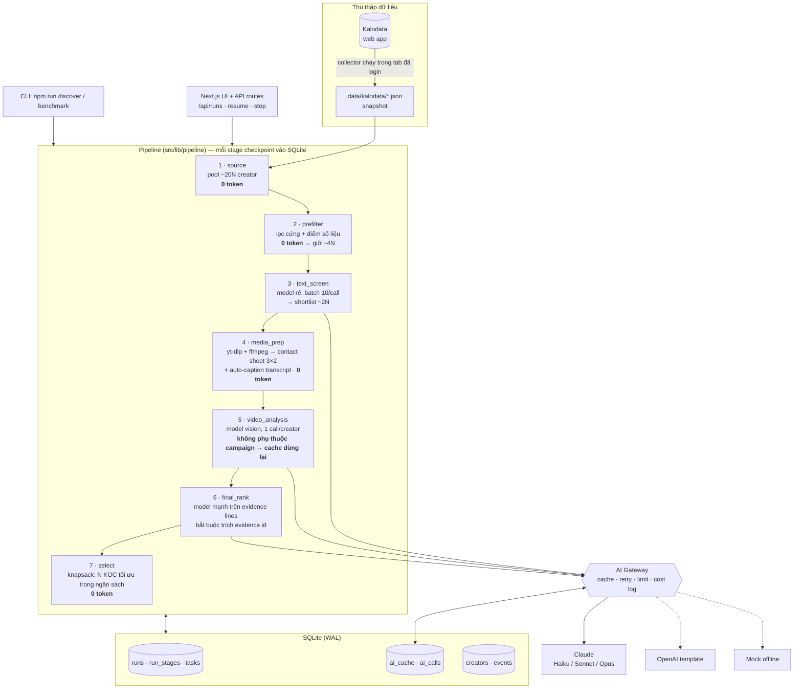

# Kiến trúc — AI KOC Discovery

## 1. Tổng quan

Hệ thống là một **pipeline dạng phễu (funnel)**: càng xuống sâu, mỗi creator càng tốn nhiều AI hơn, nên số creator phải giảm nhanh. Phần lớn việc loại bỏ được làm bằng số liệu (0 token), AI chỉ được dùng ở chỗ số liệu không trả lời được (phong cách nội dung, chất lượng video, rủi ro thương hiệu).



Với brief demo (N = 5): pool 100 → prefilter giữ 20 → text AI 20 creator (**2 call**) → video AI 10 creator (**10 call**) → final 10 creator (**1 call**) → chọn 5. Tổng **13 call AI** cho 100 creator được nghiên cứu.

## 2. Các quyết định chính

### 2.1 Funnel rẻ → đắt (đòn bẩy lớn nhất cho token efficiency)

| Stage | Chi phí / creator | Số creator (N=5) | Vì sao ở vị trí này |
|---|---|---|---|
| prefilter | 0 | 100 | Follower, khán giả, ngành hàng, engagement, chi phí là **số** → không cần AI để loại 80% pool |
| text_screen | rất thấp (Haiku, batch) | 20 | Đọc caption/sản phẩm để hiểu ngách, rủi ro — việc text đơn giản |
| video_analysis | cao nhất (vision) | 10 | Chỉ creator đã qua 2 vòng mới đáng tốn tiền xem video |
| final_rank | trung bình (Opus, text gọn) | 10 | Cần suy luận tốt nhất nhưng input đã được nén thành evidence lines |

Kích thước funnel nằm ở `funnelFor()` (`src/lib/config.ts`) và scale theo N.

### 2.2 Model tiering

Mỗi stage dùng model rẻ nhất đủ chất lượng cho việc đó (override bằng env `MODEL_*`):

- `text_screen` → `claude-haiku-5-5` ($0.10 / $0.50 per MTok): phân loại text hàng loạt.
- `video_analysis` → `claude-sonnet-5-5` ($2 / $10): vision tốt, rẻ hơn Opus 2 lần.
- `final_rank` → `claude-opus-5-5` ($4 / $20): suy luận + viết lý do có trích dẫn, chỉ chạy trên shortlist.

`output_config.effort` = `low` cho screen/video, `medium` cho final → giảm thinking token (tính như output token).

### 2.3 Phân tích video *không phụ thuộc campaign* → cache dùng lại

Prompt `video_analysis` **không chứa brief**. Output là "hồ sơ nội dung" khách quan của creator (format, có thoa lên da không, chất lượng quay, persona, brand safety...). Cache key = hash(ảnh + caption + transcript + prompt version), nên:

- Resume sau crash: 0 token cho phần đã phân tích.
- Campaign sau (son, serum, kem dưỡng...) gặp lại creator: **0 token cho stage đắt nhất**. Ở quy mô 500 KOC/tháng với tệp creator lặp lại nhiều, đây là khoản tiết kiệm lớn nhất về dài hạn.
- Việc đánh giá "hợp với campaign không" được dồn cho `final_rank`, chạy trên text gọn.

### 2.4 Contact sheet thay vì video / nhiều ảnh

Claude không nhận video; gửi nhiều frame full-res thì đắt. `media_prep` lấy 6 frame cố định (~1s cho hook, rồi 20/40/60/80/95%), resize 240×426 và ghép thành 1 ảnh 3×2 (720×852):

- Token ảnh ≈ (w×h)/750 ≈ **~820 token / video**, so với ~9.6k token nếu gửi 6 frame 1080p riêng lẻ (bị resize về 1568px cạnh dài) → **giảm ~90%** token hình ảnh.
- Vẫn đủ thấy: hook mở đầu, creator có lên hình không, có cận texture / thoa lên da không, bối cảnh, chất lượng quay.
- Transcript lấy từ **auto-caption của TikTok** (yt-dlp `--write-auto-subs`) → miễn phí, không cần chạy ASR.
- 2 video của 1 creator được gộp vào **1 call** → system prompt chỉ tính 1 lần.
- Video gốc bị xoá sau khi cắt frame (chỉ giữ sheet ~60KB) → disk không phình khi scale.

### 2.5 Batching, prompt caching, input gọn

- `text_screen` batch 10 creator / call; `final_rank` batch 10 / call.
- Phần tĩnh (rubric + brief) đặt ở `system` với `cache_control` → batch thứ 2 trở đi chỉ trả ~5–10% giá input cho phần đó.
- Creator được serialize thành "thẻ" ~150 token (dòng gọn, số rút gọn `85k`, `6.1%`) thay vì JSON raw vài nghìn token.
- Ref ngắn `c3`, `c3.v1.o2` thay vì UUID/handle dài.

### 2.6 Structured outputs + Zod

Mọi call AI dùng JSON schema (`output_config.format` với Claude, `response_format` strict với OpenAI) sinh từ Zod (`src/lib/ai/schema.ts`). Model luôn trả JSON hợp lệ → không tốn token/call để "sửa format", code parse an toàn. Output vẫn được Zod validate lại; sai schema → retry.

### 2.7 Bằng chứng có ID + kiểm tra trích dẫn (chống bịa)

`evidence.ts` biến số liệu và quan sát video thành danh sách bằng chứng có ID:

```
[c3.m1] Followers 85k; trung bình 42k view/video (reach top 12% pool)
[c3.a1] Khán giả: 82% đúng giới tính mục tiêu; 61% trong độ tuổi 18-30
[c3.v1.o2] [frame 3 @6.2s] Cận cảnh thoa kem lên mu bàn tay, không vệt trắng — "thấm nhanh lắm nha"
```

`final_rank` bắt buộc mỗi lý do/rủi ro trích 1–3 ID. Code kiểm tra lại: ID không tồn tại hoặc thuộc creator khác bị loại và ghi vào `invalidEvidence`. UI cho bấm vào ID để xem bằng chứng, video evidence hiển thị contact sheet và **khoanh đúng frame** được trích.

### 2.8 Điểm cuối "neo" vào số liệu + tối ưu ngân sách

- `final = 0.7 × fit_score (AI, theo rubric) + 0.3 × dataScore (số liệu thuần)` → AI quyết định chính nhưng không lệch khỏi số liệu thật.
- `select` giải **knapsack có ràng buộc số lượng**: chọn đúng N creator có tổng điểm cao nhất mà tổng chi phí ≤ ngân sách (DP chính xác khi nhỏ, greedy khi lớn). Top-5 điểm cao nhất có thể vượt ngân sách hoặc kém hiệu quả hơn 1 tổ hợp khác.
- Chi phí booking ước tính theo **rate card theo tier follower** (`DEFAULT_RATE_CARD` trong `scoring.ts`) — đây là giả định, thay bằng báo giá thực tế khi có.

### 2.9 Reliability: checkpoint 2 cấp + idempotent + lease

| Cơ chế | Chỗ | Tác dụng |
|---|---|---|
| Checkpoint cấp stage | `run_stages` | Stage xong → lưu output → resume bỏ qua |
| Checkpoint cấp task | `tasks` | Trong stage, task xong không chạy lại; task `running` của process chết được reset `pending` |
| Plan deterministic | `StageDef.plan` | Resume lập lại đúng danh sách task (INSERT OR IGNORE) |
| Idempotent exec + `ai_cache` | `gateway.ts` | Crash *sau khi* trả tiền AI nhưng *trước khi* ghi task → lần sau trúng cache, không trả 2 lần |
| Media cache trên đĩa | `media/video.ts` | Không tải lại video đã xử lý |
| Lease + heartbeat 15s | `runs.lease_*` | Mỗi run chỉ 1 worker; worker chết → lease hết hạn 60s → worker khác tiếp quản |
| Dead-owner detection | `isDeadLocalOwner` | Cùng máy, PID chủ lease không còn → tiếp quản ngay, không chờ 60s |
| Retry 2 tầng | SDK (429/5xx) + gateway/runner (backoff + jitter) | Lỗi tạm thời không làm hỏng run; `max_tokens` bị cắt → retry với gấp đôi |
| Tolerate failures | `media_prep`, `video_analysis` | 1 video không tải được không làm fail cả run (creator đó chỉ thiếu điểm video) |
| Graceful stop | `/api/runs/:id/stop` | Dừng nhận task mới, task đang chạy làm nốt, trạng thái `interrupted` |

Benchmark kill cứng process (`process.exit`) giữa stage `video_analysis` rồi resume ở process mới, kiểm tra **0 call bị trả tiền 2 lần** và kết quả giống run không bị gián đoạn.

### 2.10 Thu thập dữ liệu Kalodata

Kalodata không có public API cho tài khoản thường, web app có lớp anti-bot (URL obfuscate). Thay vì giả lập browser server-side hay lưu mật khẩu/cookie trong backend:

1. **Collect** — `scripts/kalodata-collector.js` chạy *trong tab Kalodata đã login*, gọi chính endpoint nội bộ (`/creator/queryList`, ...) bằng session hiện tại, xuất 1 file snapshot JSON.
2. **Import** — `KalodataSource` đọc `data/kalodata/*.json` và map về `CreatorRecord` chuẩn hoá.

Ưu điểm: không đụng credential, không vượt anti-bot, snapshot có version → benchmark tái lập được. Production: thay bước 1 bằng Kalodata API (gói doanh nghiệp) hoặc worker Playwright có session riêng; interface `DataSource` không đổi.

## 3. Scalability: 50–500 KOC

| N | Pool | Text AI | Video AI | Final | AI calls (≈) |
|---|---|---|---|---|---|
| 5 | 100 | 20 | 10 | 10 | 13 |
| 50 | 1 000 | 200 | 100 | 100 | 130 |
| 500 | 10 000 | 2 000 | 1 000 | 1 000 | 1 300 |

Hướng scale đã được chuẩn bị sẵn trong thiết kế:

- **Task là đơn vị độc lập** → đổi SQLite sang Postgres, worker kéo task bằng `SELECT … FOR UPDATE SKIP LOCKED`; nhiều worker chạy song song, lease giữ an toàn.
- **Message Batches API** (giảm 50% giá, xử lý async ≤ 24h): `text_screen` và `video_analysis` không cần realtime → mỗi task map 1-1 thành 1 batch request (`custom_id = task_key`). Projection trong BENCHMARK.md có cột này.
- **Tách worker media** (CPU/băng thông) khỏi worker AI; `MEDIA_CONCURRENCY`, `AI_CONCURRENCY` điều chỉnh độc lập theo rate limit.
- **Cache xuyên campaign** (2.3) làm chi phí biên giảm dần khi tệp creator lặp lại.
- Prefilter là O(n) thuần tính toán; 10k creator vẫn < 1 giây.

## 4. Data model (SQLite)

| Bảng | Vai trò |
|---|---|
| `runs` | 1 lần discovery: brief, config snapshot, status, lease, active time, result |
| `run_stages` | checkpoint cấp stage + output tổng hợp + active time |
| `tasks` | checkpoint cấp task (input, output, attempts, error) |
| `creators` | creator chuẩn hoá, dùng chung giữa các run |
| `ai_cache` | content-addressed cache kết quả AI |
| `ai_calls` | log từng call: model, token (input / cache read / cache write / output), ảnh, cost, latency, cache hit |
| `events` | log tiến độ cho UI |

## 5. Cấu trúc code

```
src/lib/
  config.ts            env, model tiering, funnel sizing
  db.ts                SQLite schema + migrate
  ai/                  gateway (cache/retry/limit/log), providers (anthropic, openai, mock), pricing, schema
  sources/             DataSource: kalodata (snapshot import), fixture (synthetic offline)
  media/video.ts       yt-dlp + ffmpeg → contact sheet + transcript
  pipeline/
    runner.ts          orchestrator: checkpoint, lease, retry, stop/resume
    stage.ts           StageDef (plan → exec → reduce)
    stages/*.ts        7 stage
    scoring.ts         prefilter scoring (0 token) + rate card
    evidence.ts        evidence ids + validation
    optimizer.ts       knapsack chọn N KOC trong ngân sách
    prompts.ts         system prompts (versioned)
    schemas.ts         Zod schemas cho structured outputs
src/app/               Next.js UI + API routes
scripts/               CLI discover, benchmark, gen-fixtures, kalodata-collector
```
