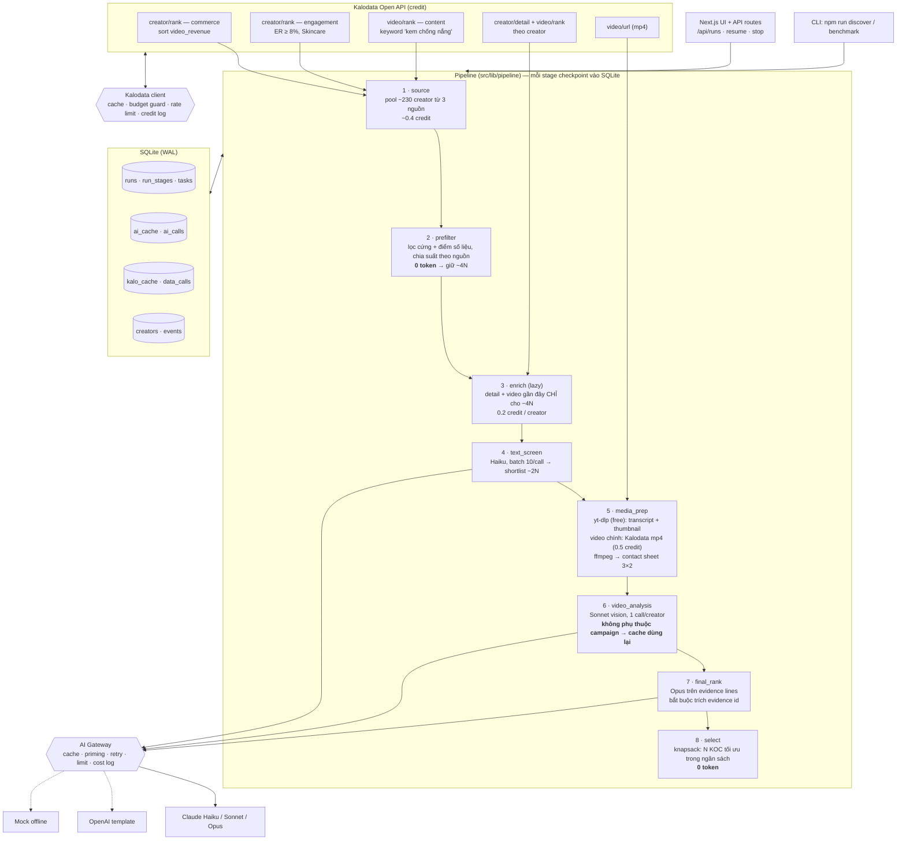

# Kiến trúc — AI KOC Discovery

## 1. Tổng quan

Hệ thống là một **pipeline dạng phễu (funnel)**: càng xuống sâu, mỗi creator càng tốn nhiều chi phí hơn (credit dữ liệu + token AI), nên số creator phải giảm nhanh. Phần lớn việc loại bỏ được làm bằng số liệu (0 token). AI chỉ dùng cho những gì số liệu không trả lời được: phong cách nội dung, chất lượng video, rủi ro thương hiệu.

Có **2 loại chi phí** được tối ưu song song:

| Loại | Đơn vị | Ví dụ |
|---|---|---|
| Dữ liệu (Kalodata Open API) | credit (1 ≈ $0.1) | rank 0.1 / 100 dòng · detail 0.1 · video URL **0.5** |
| AI (Claude) | token | Haiku $0.1/$0.5 · Sonnet $2/$10 · Opus $4/$20 per MTok |



Brief demo (N = 5): pool 234 → prefilter giữ 20 → enrich 20 → text AI 18 (**2 call**) → video AI 10 (**10 call**) → final 10 (**1 call**) → chọn 5. Tổng **13 call AI + ~9.4 credit**, khoảng **$1.33 / run lạnh**, 0 cho run lặp lại.

## 2. Các quyết định chính

### 2.1 Funnel rẻ → đắt (đòn bẩy lớn nhất)

| Stage | Chi phí / creator | Số creator (N=5) | Vì sao ở vị trí này |
|---|---|---|---|
| source | ~0.002 credit | 234 | Rank API tính theo trang 100 dòng → pool lớn gần như miễn phí |
| prefilter | 0 | 234 | Follower, ngành hàng, view, GMV, tỷ lệ video/live, chi phí là **số**, không cần AI |
| enrich | 0.2 credit | 20 | Detail + danh sách video chỉ lấy cho ứng viên đáng xem (lazy enrichment) |
| text_screen | ~$0.0002 (Haiku, batch) | 18 | Đọc caption / bio / cơ cấu bán hàng để hiểu ngách và rủi ro |
| media_prep + video_analysis | 0.5 credit + ~$0.02 | 10 | Đắt nhất → chỉ cho shortlist |
| final_rank | ~$0.018 (Opus, text gọn) | 10 | Suy luận tốt nhất nhưng input đã nén thành evidence lines |

Kích thước funnel ở `funnelFor()` (`src/lib/config.ts`), scale theo N.

### 2.2 Multi-signal retrieval (3 nguồn) + chia suất prefilter

Kalodata là dữ liệu **TikTok Shop**. Lần chạy đầu chỉ xếp theo doanh thu, pool toàn affiliate "deal-poster" (quảng bá 300–500 sản phẩm, ER < 1%), AI chấm thấp đồng loạt. Vì vậy pool lấy từ 3 nguồn bổ sung cho nhau, mỗi nguồn ~0.1 credit:

1. **commerce**: xếp theo `video_revenue` (không phải tổng doanh thu vốn bị seller livestream chiếm) → creator chứng minh được khả năng bán qua video.
2. **engagement**: `engagement_rate = MEDIUM` (≥ 8%) trong ngành Skincare, xếp theo doanh thu video → creator có sức hút tự nhiên và đúng ngành chăm da.
3. **content**: `video/rank` với keyword `"kem chống nắng"`, `"chống nắng"` → creator **đã làm** đúng loại nội dung. (Search của Kalodata nhạy theo cụm từ: "kem chống nắng" trả 30 creator, "chống nắng" chỉ 4.)

Prefilter **chia đều suất giữ lại theo nguồn**, nên một nhóm (vd affiliate bán mạnh) không chiếm hết 20 suất enrich. Filter rẻ được đẩy xuống API: VN, ngành hàng, khoảng follower, `creator_type = INDEPENDENT` (loại tài khoản shop/brand).

### 2.3 Lazy enrichment

Gọi detail + video cho cả pool 234 creator tốn ~47 credit. Chỉ gọi cho 20 creator qua prefilter thì tốn 4 credit (**giảm ~90%**). Sau khi enrich, điểm số liệu được **chấm lại** trên dữ liệu đầy đủ (engagement thật từ video, keyword trong caption, tỷ lệ view quảng cáo, số sản phẩm/shop đang quảng bá) và áp lại hard filter.

### 2.4 Model tiering

Mỗi stage dùng model rẻ nhất đủ chất lượng (override bằng env `MODEL_*`):

- `text_screen` → `claude-haiku-5-5`: phân loại text hàng loạt.
- `video_analysis` → `claude-sonnet-5-5`: vision tốt, rẻ bằng một nửa Opus.
- `final_rank` → `claude-opus-5-5`: suy luận + viết lý do có trích dẫn, chỉ chạy trên shortlist.

`output_config.effort` = `low` cho screen/video, `medium` cho final. Opus/Sonnet bật server-side refusal fallback.

### 2.5 Phân tích video *không phụ thuộc campaign* → cache dùng lại

Prompt `video_analysis` **không chứa brief**. Output là "hồ sơ nội dung" khách quan (format, có thoa lên da không, cận texture, chất lượng quay, persona, brand safety…). Cache key = hash(ảnh + caption + transcript + prompt version), nên:

- Resume sau crash: 0 token cho phần đã phân tích.
- Campaign sau (son, serum…) gặp lại creator: **0 token + 0 credit** cho phần đắt nhất (contact sheet cũng cache trên đĩa).
- Việc đánh giá "hợp campaign không" để `final_rank` làm trên text gọn.

### 2.6 Media: miễn phí trước, trả phí có kiểm soát, contact sheet

- **yt-dlp (miễn phí)** lấy **auto-caption tiếng Việt** của TikTok (transcript đầy đủ lời nói, không cần chạy ASR) + thumbnail cho mọi video.
- TikTok hiện chặn format video với client không phải app (yt-dlp chỉ nhận được audio, kể cả khi impersonate), nên **video chính** của mỗi creator lấy mp4 qua Kalodata `video/url` (0.5 credit). Video thứ 2 chỉ dùng thumbnail + transcript (miễn phí). Cấu hình qua `KALODATA_VIDEO_URL_FALLBACK = primary | all | off`.
- `video/url` là API async: lỗi `1054 "Video is being fetched"` không bị tính credit → client chờ 5s rồi gọi lại.
- 6 frame tại mốc cố định (~1s cho hook, rồi 20/40/60/80/95%) → resize 240×426 → **contact sheet 3×2 (720×852)**. Token ảnh Claude ≈ (w×h)/750 ≈ **~820 token / video**, so với ~9.6k nếu gửi 6 frame full-res → **giảm ~90%**. Video gốc bị xoá sau khi cắt frame, chỉ giữ sheet ~60KB.
- 2 video của 1 creator gộp **1 call** → system prompt chỉ tính 1 lần.

### 2.7 Batching, prompt caching (có priming), input gọn

- `text_screen` / `final_rank` batch 10 creator / call.
- Phần tĩnh (rubric + brief) nằm ở `system` có `cache_control`.
- **Cache priming**: lần đầu, 2 batch chạy song song nên **cả 2 đều ghi cache** (đo được: `cache_write 2194` ×2, `cache_read 0`). Gateway giờ cho call đầu tiên của mỗi (model, system) chạy trước, các call sau chờ rồi mới chạy song song để đọc cache (~0.05–0.1× giá input).
- Creator được serialize thành "thẻ" ~150 token (số rút gọn `85k`, `6.1%`) thay vì JSON raw vài nghìn token. Ref ngắn `c3`, `c3.v1.o2`.

### 2.8 Structured outputs + Zod, ghi nhận cả call hỏng

- Mọi call AI dùng JSON schema sinh từ Zod (`src/lib/ai/schema.ts`). Output vẫn được Zod validate lại.
- **Bug thật đã gặp và sửa**: hàm làm "strict" schema xoá keyword `format` của JSON Schema, nhưng xoá luôn **property tên `format`** của video schema, khiến 10/10 call video fail validate. Đã sửa: không đụng vào tên key trong `properties`.
- Call trả về JSON sai schema hoặc bị cắt `max_tokens` **vẫn tốn tiền** → provider đính kèm `usage` vào lỗi, gateway ghi vào `ai_calls` với `ok = 0`. Chi phí báo cáo luôn trung thực.

### 2.9 Bằng chứng có ID + kiểm tra trích dẫn (chống bịa)

`evidence.ts` biến số liệu và quan sát video thành danh sách bằng chứng có ID:

```
[c6.m1] Followers 76k; 73.6M view nội dung / 30 ngày; trung vị 3.2M view của các video nổi bật (reach top 16% pool)
[c6.m6] 100% doanh thu từ video, 0% từ livestream; quảng bá 161 sản phẩm / 128 shop; trung bình 19% view video đến từ quảng cáo
[c6.v1.o1] [frame 1 @1s] Mặt đã chấm nhiều điểm kem trắng ở má, mũi, trán; tay cầm tuýp kem màu hồng
```

`final_rank` bắt buộc mỗi lý do/rủi ro trích 1–3 ID. Code kiểm tra lại: ID không tồn tại hoặc của creator khác bị loại và ghi vào `invalidEvidence`. UI cho bấm vào ID để xem bằng chứng; video evidence hiển thị contact sheet và **khoanh đúng frame** được trích.

### 2.10 Điểm cuối "neo" vào số liệu + tối ưu ngân sách

- `final = 0.7 × fit_score (AI, rubric) + 0.3 × dataScore (số liệu)`.
- `select` giải **knapsack có ràng buộc số lượng**: chọn đúng N creator có tổng điểm cao nhất mà tổng chi phí ≤ ngân sách (DP chính xác khi nhỏ, greedy khi lớn).
- Chi phí booking ước tính theo **rate card theo tier follower** (`DEFAULT_RATE_CARD` trong `scoring.ts`). Đây là giả định.

### 2.11 Reliability

| Cơ chế | Chỗ | Tác dụng |
|---|---|---|
| Checkpoint cấp stage | `run_stages` | Stage xong → lưu output → resume bỏ qua |
| Checkpoint cấp task | `tasks` | Task xong không chạy lại; task `running` của process chết được reset `pending` |
| Plan deterministic | `StageDef.plan` | Resume lập lại đúng danh sách task (INSERT OR IGNORE) |
| Idempotent + `ai_cache` | `ai/gateway.ts` | Crash *sau khi* trả tiền AI nhưng *trước khi* ghi task → lần sau trúng cache |
| `kalo_cache` + media cache đĩa | `kalodataApi.ts`, `media/video.ts` | Không trả credit 2 lần; signed URL chỉ dùng lại khi chưa hết hạn |
| Budget guard credit | `KALODATA_MAX_CREDITS_PER_RUN` (mặc định 12) | Chặn **trước** khi gọi nếu vượt trần |
| Rate limit theo endpoint | `kalodataApi.ts` | rank / video: 10 req / 10s; detail: 500 req / 10s |
| Lease + heartbeat | `runs.lease_*` | Mỗi run chỉ 1 worker; worker chết → lease hết hạn → tiếp quản |
| Dead-owner detection | `isDeadLocalOwner` | Cùng máy, PID chủ lease không còn → tiếp quản ngay |
| Retry nhiều tầng | SDK + gateway + runner + Kalodata client | Lỗi tạm thời không làm hỏng run; `max_tokens` bị cắt → tăng gấp đôi |
| Tolerate failures | enrich, media_prep, video_analysis | 1 creator/video lỗi không làm fail cả run |
| Graceful stop | `/api/runs/:id/stop` | Dừng nhận task mới, task đang chạy làm nốt |

Benchmark kill cứng process (`process.exit(137)`) giữa `video_analysis`, resume ở process mới, kiểm tra **0 call bị trả tiền 2 lần**.

## 3. Scalability: 50–500 KOC

| N | Pool | Enrich + text AI | Video AI | AI | Kalodata | Tổng ≈ |
|---|---|---|---|---|---|---|
| 5 | 100/nguồn | 20 | 10 | $0.39 | 9.4 cr | $1.33 |
| 50 | 1 000/nguồn | 200 | 100 | $3.9 | 94 cr | $13.3 |
| 500 | 10 000/nguồn | 2 000 | 1 000 | $39 | 940 cr | $133 |

Ở quy mô lớn, **chi phí dữ liệu (video URL 0.5 credit) vượt chi phí AI**. Hướng xử lý đã chuẩn bị sẵn:

- **Cache xuyên campaign**: hồ sơ video không phụ thuộc campaign → tệp creator lặp lại thì chi phí biên về 0.
- `KALODATA_VIDEO_URL_FALLBACK=off` + chỉ dùng thumbnail + transcript cho tầng đầu; chỉ trả 0.5 credit cho top cuối.
- **Message Batches API** (−50% giá AI) cho `text_screen` / `video_analysis` (không cần realtime): mỗi task map 1-1 thành 1 batch request (`custom_id = task_key`).
- **Task độc lập** → đổi SQLite sang Postgres, worker kéo task bằng `SELECT … FOR UPDATE SKIP LOCKED`; lease giữ an toàn khi nhiều worker.
- Tách worker media (CPU/băng thông) khỏi worker AI; `MEDIA_CONCURRENCY`, `AI_CONCURRENCY` chỉnh độc lập theo rate limit.

## 4. Data model (SQLite)

| Bảng | Vai trò |
|---|---|
| `runs` | 1 lần discovery: brief, config snapshot, status, lease, active time, result |
| `run_stages` | checkpoint cấp stage + output + active time |
| `tasks` | checkpoint cấp task (input, output, attempts, error) |
| `creators` | creator chuẩn hoá (bio đã che SĐT/email), dùng chung giữa các run |
| `ai_cache` / `ai_calls` | cache kết quả AI; log từng call (token, cost, latency, cache hit, ok) |
| `kalo_cache` / `data_calls` | cache response Kalodata; log credit trả / credit tiết kiệm nhờ cache |
| `events` | log tiến độ cho UI |

## 5. Cấu trúc code

```
src/lib/
  config.ts            env, model tiering, funnel sizing
  db.ts                SQLite schema + migrate
  ai/                  gateway (cache/priming/retry/limit/log), providers (anthropic, openai, mock), pricing, schema
  sources/
    kalodataApi.ts     Kalodata Open API client: cache, budget guard, rate limit, credit log
    kalodata.ts        search (3 nguồn) + enrich (detail + video) -> CreatorRecord
    fixture.ts         data synthetic cho chế độ offline
  media/video.ts       yt-dlp (free) / Kalodata mp4 (paid) -> contact sheet + transcript
  pipeline/
    runner.ts          orchestrator: checkpoint, lease, retry, stop/resume
    stage.ts           StageDef (plan -> exec -> reduce)
    stages/*.ts        8 stage
    scoring.ts         prefilter scoring (0 token) + rate card
    evidence.ts        evidence ids + validation
    optimizer.ts       knapsack chọn N KOC trong ngân sách
    prompts.ts         system prompts (versioned)
    schemas.ts         Zod schemas cho structured outputs
src/app/               Next.js UI + API routes
scripts/               CLI discover, benchmark, gen-fixtures
```
